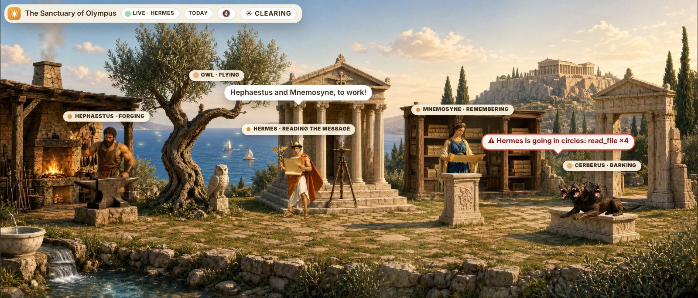
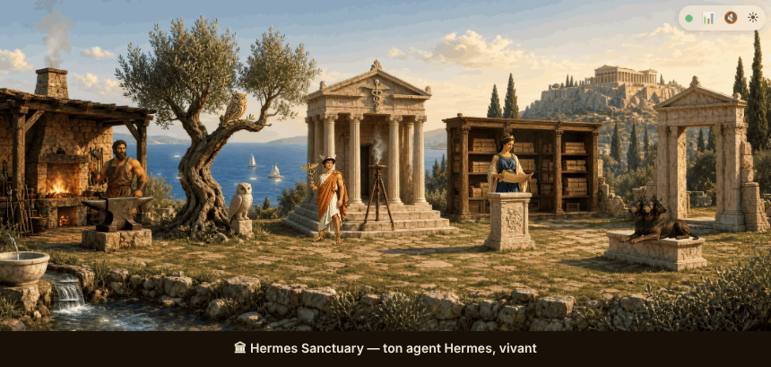
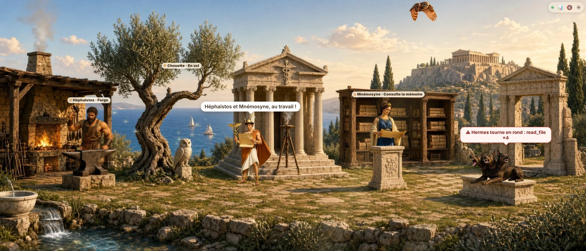

# 🏛 Hermes Sanctuary · Le Sanctuaire

*Formerly « Le Sanctuaire Solaire ». / Anciennement « Le Sanctuaire Solaire ».*

**Watch your [Hermes Agent](https://github.com/NousResearch/hermes-agent) work, live.** Every tool it uses wakes up a character on Mount Olympus: the owl flies off to search the web, Hephaestus forges code, Mnemosyne digs through files and memory, and Cerberus barks when something goes wrong.
**Regarde ton agent Hermes travailler, en direct** : chaque outil réveille un personnage de l'Olympe.


> 🇬🇧 Personal project by **[Médéric Morin](https://github.com/Med34000)**, built by *vibe coding* with AI. Shared to get **feedback, ideas and improvements**.
>
> 🇫🇷 Projet personnel de **[Médéric Morin](https://github.com/Med34000)**, construit en *vibe coding* avec l'IA. Partagé pour recevoir **des avis, des idées et des améliorations**. ([Lire en français ↓](#-en-français))

---

## 🇬🇧 English

### Install (Hermes plugin — macOS, Windows, Linux)
```bash
hermes plugins install hermes-sanctuary --enable
```

In the official [Hermes plugin catalog](https://hermes-agent.nousresearch.com/marketplace/hermes-sanctuary) since November 8, 2026. If an older Hermes doesn't find it by name: `hermes plugins install Med34000/hermes-sanctuary/hermes-sanctuary --enable`.

Restart Hermes, then:
- **Hermes Desktop**: turn on *Hermes Sanctuary* in **Capabilities → Plugins**. The panorama appears in a pane under the conversation, and as a **Sanctuaire** page in the sidebar.
- **Web dashboard**: a **Sanctuaire** tab, and a foldable strip above the **Chat** tab.

Hermes Desktop connected to a remote Hermes? See [hermes-sanctuary/README.md](hermes-sanctuary/README.md) (one extra click).

### Who does what

| Character | Wakes up when Hermes uses… |
|---|---|
| **Hermes** (coordinator) | the start and end of each turn, `send_message`, `delegate_task`, `clarify`, `cronjob` — he reads the message and hands out the work |
| **Athena's Owl** (research) | `web_search`, `web_extract`, `vision_analyze`, `browser_*` — she flies off and comes back |
| **Mnemosyne** (memory) | `read_file`, `search_files`, `memory`, `session_search`, `skill_view`, `todo` |
| **Hephaestus** (building) | `write_file`, `patch`, `terminal`, `process`, `execute_code`, `skill_manage` |
| **Cerberus** (guard) | tool and provider errors, fallback models, loops, heavy turns, budget, permissions — he barks and says why |



### What makes it useful
- **Where the work comes from**: Desktop, Discord, Telegram or ⏰ a scheduled task, even when you are not there.
- **Cerberus guards your agent**: he barks when Hermes **goes in circles** (same call again and again), **silently switches to a fallback model**, reads a **very heavy turn** (time for `/new`), goes over your **daily budget**, or waits for a **permission** — with the reason in a bubble, and a native notification in Hermes Desktop.
- **Today's journal**: turns, tools, sources, alerts, tokens and **estimated cost per model** (Hermes's own pricing), hour by hour.
- **📸 Share my day**: one click makes an image of your day with Hermes, ready to post.
- **⏪ Replay the day**: the whole day plays again in the panorama, sped up.
- **A living world**: leaves, water, forge fire and smoke move; idle characters have their own little "waiting for work" moments; doves circle the temple when Hermes delegates to subagents; night falls in the evening.
- **Two worlds**: Olympus (default) and the Clearing (the original animal companions), one click apart. English or French, from your system language.

### Privacy by design
- Only **tool names, times and counts** are recorded. Never messages, replies, tool arguments, results or file paths.
- No network call of its own, no secrets, no `.env` access, no telemetry. Details in [hermes-sanctuary/README.md](hermes-sanctuary/README.md).

### Server mode (the Clearing, with its own chat)
The first version of the project: a standalone page with its own chat (Kitsune listens, reads your letter, folders, images), installed on a Linux server and reached through an SSH tunnel. It keeps working, but the plugin above is the recommended way.

```bash
sudo git clone https://github.com/Med34000/hermes-sanctuary /opt/sanctuaire
cd /opt/sanctuaire
./install.sh --dry-run   # shows the plan, changes nothing
./install.sh             # guided install, asks before every step
```
Details, manual install and troubleshooting: **[INSTALL.md](INSTALL.md)**.

### Ideas & contributions welcome 🙌
New worlds and characters, better tool mappings, translations, support for other agents: **[start a discussion](../../discussions)** or **[open an issue](../../issues/new/choose)**. See [CONTRIBUTING.md](CONTRIBUTING.md), the [ROADMAP](ROADMAP.md) and [how to make your own world](docs/ARCHITECTURE.md#créer-un-nouvel-environnement).

---

## 🇫🇷 En français



### Installer (plugin Hermes — Mac, Windows, Linux)
```bash
hermes plugins install hermes-sanctuary --enable
```

Dans le [catalogue officiel des plugins Hermes](https://hermes-agent.nousresearch.com/marketplace/hermes-sanctuary) depuis le 8 novembre 2026. Si ton Hermes, plus ancien, ne le trouve pas par son nom : `hermes plugins install Med34000/hermes-sanctuary/hermes-sanctuary --enable`.

Redémarre Hermes, puis :
- **Hermes Desktop** : active *Hermes Sanctuary* dans **Capabilities → Plugins**. Le panorama s'affiche dans un panneau sous la conversation, et dans une page **Sanctuaire**.
- **Tableau de bord web** : un onglet **Sanctuaire**, et un bandeau repliable au-dessus de l'onglet **Chat**.

### Qui fait quoi
- **Hermès** coordonne : il lit le message et distribue le travail ;
- **la chouette d'Athéna** cherche sur le web ;
- **Mnémosyne** fouille les fichiers et la mémoire ;
- **Héphaïstos** écrit, corrige et exécute ;
- **Cerbère** monte la garde et aboie, en disant pourquoi.



### Ce qui le rend utile
- **D'où vient le travail** : Desktop, Discord, Telegram ou ⏰ une tâche planifiée, même quand tu n'es pas là.
- **Cerbère aboie** quand Hermes **tourne en rond**, **bascule en silence sur un modèle de secours**, lit un **tour trop lourd** (pense à `/new`), dépasse ton **budget du jour** ou attend une **autorisation**. La raison s'affiche dans une bulle, et Hermes Desktop envoie une notification.
- **Journal du jour** : tours, outils, provenances, alertes, tokens et **coût estimé par modèle** (avec les tarifs de Hermes), heure par heure.
- **📸 Partager** : une image de ta journée avec Hermes, prête à poster.
- **⏪ Rejouer la journée** : toute ta journée en accéléré dans le panorama.
- **Un monde vivant** : feuillage, eau, feu de la forge et fumées bougent ; chaque personnage a ses petits moments d'attente ; des colombes tournent au-dessus du temple quand Hermes délègue ; le soir, la nuit tombe.
- **Deux univers** : l'Olympe (par défaut) et la Clairière (les compagnons animaux d'origine), à un clic. En français ou en anglais selon la langue du système.

### Confidentialité
- Seuls des **noms d'outils, des heures et des compteurs** sont notés, jamais le contenu des conversations, les arguments, les résultats ni les chemins de fichiers.
- Aucun appel réseau de sa part, aucun secret, aucun accès au `.env`, aucune télémétrie.

### Mode serveur (la Clairière, avec son propre chat)
La première version du projet : une page autonome avec son propre chat, sur un serveur Linux, par tunnel SSH. Elle marche toujours, mais le plugin est la voie recommandée. Tous les détails sont dans **[INSTALL.md](INSTALL.md)**.

### Ton avis et tes idées m'intéressent 🙌
Une critique, une idée, un nouvel univers, une traduction : **[lance une discussion](../../discussions)** ou **[ouvre une issue](../../issues/new/choose)**. Voir [CONTRIBUTING.md](CONTRIBUTING.md), la [feuille de route](ROADMAP.md) et [comment créer ton univers](docs/ARCHITECTURE.md#créer-un-nouvel-environnement).

---

## License / Licence
**Open source.**
- **Code**: [Apache 2.0](LICENSE). Use it, modify it, share it, build on it, as long as you keep the [NOTICE](NOTICE) that credits the author.
- **Images & characters**: [CC BY 4.0](LICENSE-ASSETS). Free to reuse, with credit.
- 🇫🇷 Le code est sous Apache 2.0 et les images sous CC BY 4.0 : tout est libre, à condition de **garder le crédit « Hermes Sanctuary — Médéric Morin »** (fichier [NOTICE](NOTICE)).

**Created by [Médéric Morin](https://github.com/Med34000)** · [X @Med_34000](https://x.com/Med_34000) · [LinkedIn](https://www.linkedin.com/in/mederic-morin-auto-ia-tech/) · [iatelier.ch](https://iatelier.ch)

Independent project, not affiliated with Nous Research. / Projet indépendant, sans lien avec Nous Research.

*2026-11-04 ≈18:55, mis à jour 2026-11-05 ≈11:35 et ≈17:50 (Europe/Zurich) — Claude (Cowork) — Anthropic, Claude Opus 5.5, pour Médéric Morin*
