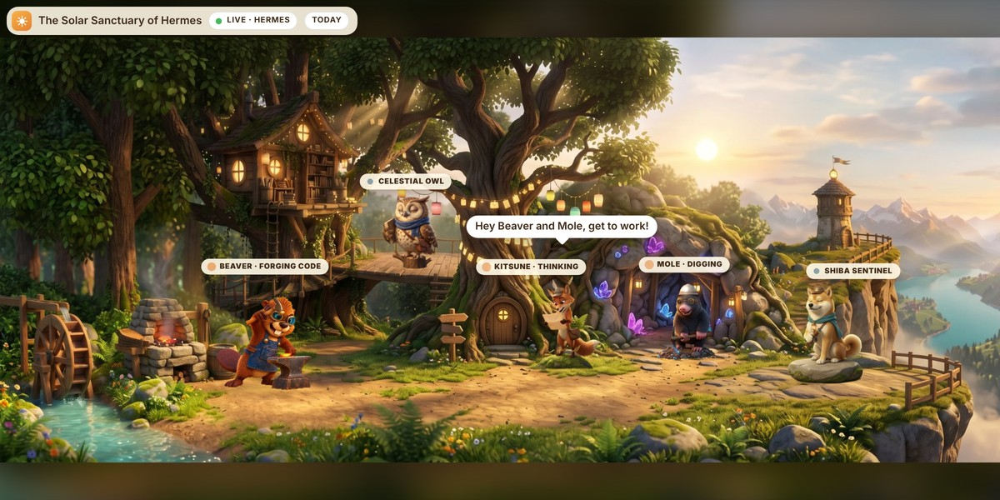
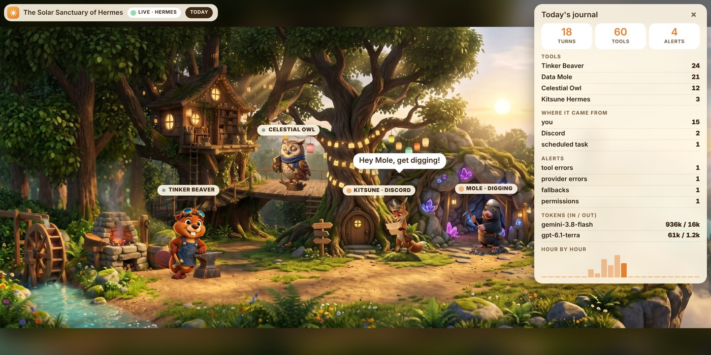

# 🏛 Hermes Sanctuary · Le Sanctuaire — Hermes plugin

*Formerly « Le Sanctuaire Solaire ». / Anciennement « Le Sanctuaire Solaire ».*

**A living view of your agent.** Five animated characters wake up when Hermes uses their tools, in two worlds:

- **Olympus** (default): Hermes reads the message and hands out the work, Athena's owl flies off to search the web, Hephaestus forges code behind his anvil, Mnemosyne searches files and memory, and Cerberus barks at errors and guards approvals. Leaves, water, forge fire and smoke move gently, and the idle characters keep living: one or two at a time play a short "waiting for work" moment of their own (Hephaestus wipes his brow, Cerberus yawns…).
- **The Clearing**: the owl, the beaver, the mole, the Shiba and Kitsune with her paper planes.

Switch worlds with the round button in the top-right corner (🏛 / ☀); the choice is remembered.

Works in **Hermes Desktop** (macOS, Windows, Linux) and in the **web dashboard**. English or French, from your system language.






## Install

```bash
hermes plugins install hermes-sanctuary --enable
```

In the official [Hermes plugin catalog](https://hermes-agent.nousresearch.com/marketplace/hermes-sanctuary) since November 8, 2026. If an older Hermes doesn't find it by name: `hermes plugins install Med34000/hermes-sanctuary/hermes-sanctuary --enable`.

Then restart Hermes (gateway / dashboard) so the hooks and routes load.

- **Hermes Desktop**: open **Capabilities → Plugins**, turn on **Hermes Sanctuary**. A pane appears under the conversation, and a **Sanctuaire** page in the sidebar.
- **Web dashboard**: a **Sanctuaire** tab, and a foldable strip above the **Chat** tab.

You chat with Hermes as usual; the Sanctuary shows what it is doing, including background work (crons, Discord, other chats).

**Hermes Desktop connected to a remote Hermes (a server)?** The pane half lives on your computer: in **Capabilities → Plugins → Install from Git**, enter `Med34000/hermes-sanctuary/hermes-sanctuary` and turn on **Force reinstall** if the plugin is already on the server.

## What it shows

- **Who is working**: each tool wakes its character; Hermes (Kitsune in the Clearing) calls out and hands the work out.
- **A clean scene**: a character's name shows while it works or when you hover it; the controls are four small icons in the top-right corner (live dot, 📊 journal, sound, world). In a wide, low pane the panorama crops the sky and the ground, never a character.
- **Where the work comes from**: the coordinator's label shows *Discord*, *Telegram* or *⏰ your scheduled task* when Hermes works without you.
- **The guard (Cerberus, or the Shiba in the Clearing) protects you**: he barks on tool and provider errors, when Hermes **silently switches to a fallback model**, and when a permission is waiting (with Hermes's own short description, e.g. "recursive delete", and where to answer). In Hermes Desktop, a fallback, a loop, a heavy turn, an exceeded budget or a permission waiting on Discord/Telegram also sends a native notification.
- **Hermes going in circles**: the guard barks when Hermes calls the same tool with the same arguments again and again in one turn (4 times in its last 12 calls) — the kind of loop that burns tokens for nothing.
- **Daily budget**: the journal shows today's **estimated cost** (Hermes's own pricing, per model). Set a daily budget in dollars and the guard barks once the day goes over it.
- **Alerts in plain words**: every alert also appears in a bubble above the guard for a few seconds.
- **Heavy turns**: the guard growls when one turn reads more than 200,000 input tokens (a conversation grown too long: time for `/new`), and the journal lists the heaviest turns.
- **Today's journal** (📊 button): turns, tools per companion, where the work came from, errors, fallbacks, loops, heavy turns, permissions, tokens and cost per model, hour by hour with the peak.
- **Share my day**: one click makes an image of the panorama with the day's numbers (turns, tools, busiest character, cost), ready to post.
- **Replay the day**: the whole day plays again in the panorama, sped up, with a clock and a progress bar.
- **Companion cards**: click a companion to see its role, how often it worked today and its recent tools.
- **Subagents**: when Hermes delegates, doves circle the temple (Olympus) or little foxes join Kitsune (Clearing) until the subagents are done.
- **Night and sounds**: in the evening the scene darkens and fireflies come out (your local time); optional sounds (off by default), synthesised on the spot, no audio files.

## Updating

`hermes plugins update hermes-sanctuary` (or reinstall with `--force`), then restart the web dashboard. With Hermes Desktop connected to a remote Hermes, also reinstall the pane half (**Install from Git**, **Force reinstall**) and **quit and reopen the app** so its backend loads the new routes.

## What it records — privacy

- **Only names, times and counts**: tool names; turn start/end times and where a turn comes from (platform name, scheduled task name); counters of tool errors, provider errors, fallbacks, loops, heavy turns and approvals; the number of running subagents; the generic description Hermes gives for an approval ("recursive delete"); provider and model names with token counts per hour; for the replay, a list of one-letter event codes with their time (e.g. "a tool of the forge at 09:14").
- To spot a loop, a short hash of each tool call (name + arguments) is kept **in memory, for the current turn only**, and never written.
- The daily budget is kept by Hermes Desktop or your browser, not on the server.
- **Never** messages, replies, tool arguments, commands, results, error texts, file paths or ids.
- Stored in `<hermes home>/plugin-data/hermes-sanctuary/proc/` (one small JSON file per Hermes process; files older than 2 days are removed).

## Disclosure

- Hooks: `pre_tool_call`, `post_tool_call`, `pre_llm_call`, `post_llm_call`, `on_session_end`, `post_api_request`, `api_request_error`, `pre_approval_request`, `post_approval_response`, `subagent_start`, `subagent_stop`. All are observers: they never block, change or approve anything. Approvals are only shown, never answered: you answer them where Hermes asks.
- Backend routes (`/api/plugins/hermes-sanctuary/`): read-only — the merged activity, the day's events for the replay, the worlds, the theme, the page and its images, all from the plugin's own folders.
- The cost is estimated with Hermes's own pricing module (`agent.usage_pricing`), the one Hermes uses for its own usage figures; Hermes may refresh its price list (models.dev, OpenRouter) by itself. The plugin makes no network call of its own.
- No secrets, no `.env` access, no background process, no telemetry. Hermes Desktop may show native notifications (at most one per kind every 2 minutes).
- The panorama runs in a sandboxed frame that receives everything by `postMessage` and makes no request of its own.

## Make your own world

The engine and the look are separate: one environment = one `dashboard/app/themes/<id>/` folder (background, characters, positions, animations, texts). See [docs/ARCHITECTURE.md](https://github.com/Med34000/hermes-sanctuary/blob/main/docs/ARCHITECTURE.md). Ideas and new worlds are welcome in the [Discussions](https://github.com/Med34000/hermes-sanctuary/discussions).

## 🇫🇷 En bref

Hermes Sanctuary montre ce que fait ton agent : chaque outil utilisé par Hermes réveille un personnage, dans deux univers au choix, l'**Olympe** (par défaut : Hermès, Héphaïstos à sa forge, la chouette d'Athéna, Mnémosyne, Cerbère ; quand ils n'ont rien à faire, chacun a de temps en temps sa petite scène d'attente) ou la **Clairière** (Kitsune, le castor, la chouette, la taupe, le Shiba). Il fonctionne dans **Hermes Desktop** (Mac, Windows, Linux) et dans le **tableau de bord web**, en français ou en anglais selon la langue de ton système.

```bash
hermes plugins install hermes-sanctuary --enable
```

Dans le [catalogue officiel des plugins Hermes](https://hermes-agent.nousresearch.com/marketplace/hermes-sanctuary) depuis le 8 novembre 2026. Si ton Hermes, plus ancien, ne le trouve pas par son nom : `hermes plugins install Med34000/hermes-sanctuary/hermes-sanctuary --enable`.

Redémarre ensuite Hermes. Dans Hermes Desktop, active le plugin dans **Capabilities → Plugins**.

Le Sanctuaire montre aussi **d'où vient le travail** (Discord, Telegram, tâche planifiée). Le **gardien (Cerbère ou le Shiba) aboie**, avec une bulle qui dit pourquoi, quand Hermes **tourne en rond** (même outil, mêmes arguments), quand le **budget du jour** est dépassé (coût estimé avec les tarifs de Hermes), quand Hermes bascule en silence sur un modèle de secours, quand un tour devient trop lourd (plus de 200 000 tokens) ou qu'une autorisation attend. Le bouton **📊** (en haut à droite) ouvre le journal du jour, avec le coût, le réglage du budget, **📸 Partager** (une image de ta journée à poster) et **⏪ Rejouer la journée** (toute la journée en accéléré dans le panorama). Un clic sur un compagnon ouvre sa fiche, des colombes ou des renardeaux apparaissent quand Hermes délègue à des sous-agents, le décor s'assombrit le soir, et des sons discrets sont disponibles (coupés par défaut).

Seuls des **noms, des heures et des compteurs** sont notés, jamais le contenu des conversations. Aucun appel réseau, aucun secret lu.

## License

Code: [Apache 2.0](LICENSE) · Images and characters: [CC BY 4.0](LICENSE-ASSETS) — keep the credit in [NOTICE](NOTICE).

**Created by [Médéric Morin](https://github.com/Med34000)** · [X @Med_34000](https://x.com/Med_34000) · [LinkedIn](https://www.linkedin.com/in/mederic-morin-auto-ia-tech/)

Independent project, not affiliated with Nous Research.

*2026-11-05 ≈12:00, mis à jour ≈13:00, ≈15:00, ≈16:20, ≈17:00, puis 2026-11-06 ≈11:35 (Europe/Zurich) — Claude (Cowork) — Anthropic, Claude Opus 5.5, pour Médéric Morin*
